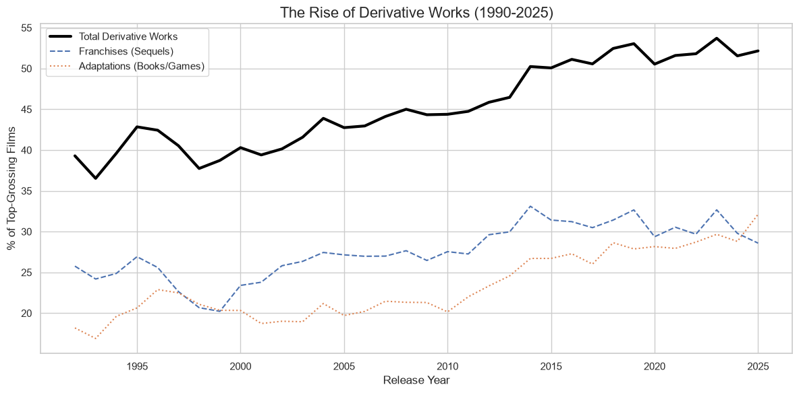
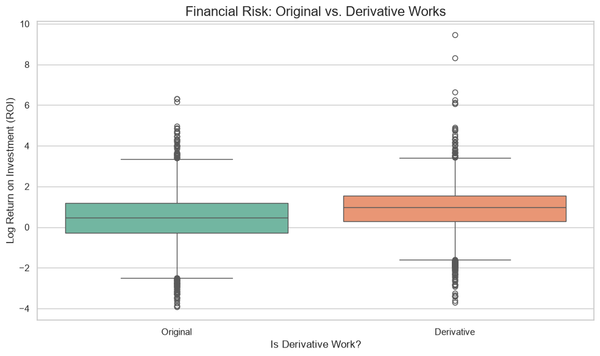
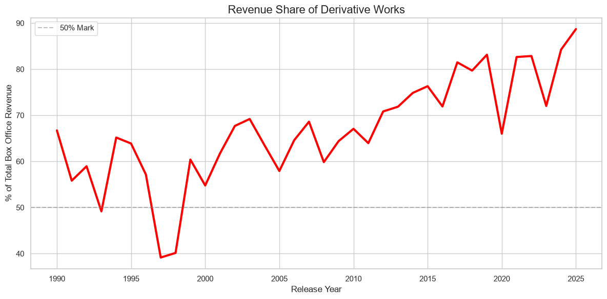

# 🎬 The Hollywood Risk Premium: Originality vs. Profitability

> **🔗 [Click here to explore the live interactive dashboard!](https://hollywood-risk.streamlit.app/)**

### *Has Hollywood lost its creativity, or is it just managing financial risk?*

Every year, audiences ask why modern cinema is dominated by sequels, remakes, and adaptations. The common narrative is a "creativity crisis"—that studios have simply run out of original ideas. 

However, an analysis of **7,000+ top-grossing films** over the last 30 years reveals a different story. It's not a lack of ideas; **it's a mathematical response to risk.**

## 📊 Key Findings
By analyzing budget, revenue, and metadata from The Movie Database (TMDB), this project quantified the exact financial incentive driving this trend:

*   **The Risk Gap:** Original films have a **34% failure rate** (returning less than their budget). In contrast, derivative works (franchises, adaptations, remakes) have a failure rate of only **18%**.
*   **The "Safe Bet" Premium:** The median Return on Investment (ROI) for an original film is **1.6x**. For a derivative work, it is **2.7x**.
*   **The Box Office Takeover:** While original films still make up roughly 50% of top releases, derivative works now capture **nearly 90% of total box office revenue**.
*   **The Self-Fulfilling Prophecy:** By starving mid-budget original films of funding, studios are training audiences to only show up for existing IP. If this continues, the "creativity crisis" may become a reality—not because writers are out of ideas, but because the next generation of original blockbusters will never get the green light.

---

## 📈 Visual Highlights

### The Shift in Strategy


### The Financial Reality: Risk vs. Reward


### Revenue Concentration


---

## 🛠️ Data Pipeline & Methodology

This isn't just a dashboard; it's the result of a full end-to-end data science pipeline.

**1. Data Acquisition (`scripts/`)**
*   Built a Python script using the TMDB API to fetch the top-grossing films per year (1980–2025).
*   Implemented rate-limiting, retry logic, and per-year JSONL storage to handle API constraints.
*   Fetched specific keyword tags for 7,300+ movies to accurately classify adaptations and remakes.

**2. Data Cleaning & Engineering (`notebooks/01_data_cleaning.ipynb`)**
*   **The Zero-Budget Trap:** Replaced `$0` budgets with `NaN`, as TMDB uses zero for missing data, not free films.
*   **Outlier Handling:** Identified and excluded streaming-era revenue fragments (e.g., Netflix films with theatrical-only box office data) and placeholder micro-budgets (<$10k).
*   **Classification:** Engineered boolean flags (`is_franchise`, `is_adaptation`, `is_remake`) and combined them into a master `is_derivative` flag.

**3. Exploratory Analysis (`notebooks/02_exploration.ipynb`)**
*   Calculated ROI distributions, failure rates, and revenue concentration over time.
*   Discovered the genre-level divide: Sci-Fi/Action rely on IP, while Comedy/Romance remain the last bastions of original storytelling.

**4. Deployment (`app.py`)**
*   Built a multi-page interactive dashboard using **Streamlit** and **Plotly** to allow users to explore the data by year, genre, and derivative category.

---

## 💻 Tech Stack
*   **Language:** Python
*   **Data Manipulation:** Pandas, NumPy
*   **Data Acquisition:** TMDB REST API, Requests
*   **Visualization:** Plotly, Seaborn, Matplotlib
*   **Deployment:** Streamlit

---

## 🚀 How to Run Locally

1. **Clone the repository:**
   ```bash
   git clone https://github.com/YOUR_USERNAME/hollywood-sequel-risk.git
   cd hollywood-sequel-risk
    ```
2. **Set up a virtual environment:**
    ```bash
    python -m venv venv
    source venv/bin/activate  # On Windows: venv\Scripts\activate
    ```
3. **Install dependencies:**
    ```bash
    pip install -r requirements.txt
    ```
4. **Add your API Key:**
Create a .env file in the root directory and add your TMDB API Read Access Token:
    ```bash
    TMDB_TOKEN=your_token_here
    ```
5. **Run the app:**
    ```bash
    streamlit run app.py
    ```
---

##⚠️ Limitations
    ** Streaming Revenue: Public databases do not track per-title streaming revenue. The ROI analysis relies on theatrical box office, which excludes the economic value of streaming platforms (Netflix, Apple TV+).

    **Categorization: Classification relies on TMDB's community-generated keywords. While extensive, some films may be misclassified or lack tags.

    **Sample: The dataset includes the top-grossing films per year (N=7,013) with valid financial data, which inherently undersamples indie films with unreported budgets.
